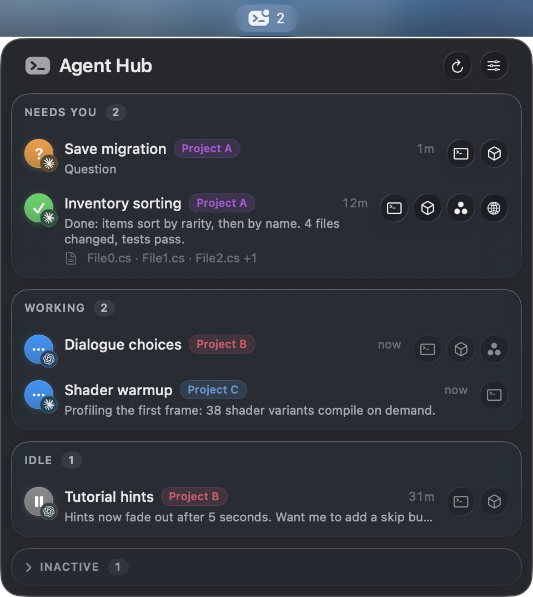

# Agent Hub

A macOS menu bar panel for running Claude Code and Codex agents across many projects. The agent monitor works next to any IDE; JetBrains Rider is the one integrated today. Optional integrations: Unity Editor, task trackers such as Asana, Claude artifacts and the Handy speech-to-text app.



## Why

ADEs are good at running agents but weak at navigating the code compared to a full IDE like Rider. JetBrains Air brings agents into the IDE, but does not handle a multi-project setup. Agent Hub adds the missing agent monitor features to Rider instead: one panel shows every agent in every project, tells you which ones are waiting for input, and jumps to the right place.

Nothing in it is tied to Rider. The panel talks to a small CLI, and the CLI talks to editors over local HTTP, so any IDE or tool can be plugged in the same way.

## What it does

- Lists every Claude Code and Codex session on the machine, grouped by state: needs you, working, idle, inactive.
- Opens the agent's terminal tab in the right Rider window, or the files it changed for review.
- Brings the Unity Editor of that project to the front, so switching projects switches both editors.
- Reopening a project in Rider resumes the Claude Code and Codex sessions it had in its terminal tabs.
- Reopens a closed project from the IDE's recent list; hold Option to open its Unity Editor too.
- Closes the Rider windows and Unity Editors of projects that no agent works in any more.
- Shows how much of the 5-hour and weekly limits Claude Code and Codex have left, flags a limit past 80%, spends a Codex usage reset, and wakes sleeping agents with one short request outside any project.
- Opens the tracker task an agent works on. Agents report their task codes and links through the `agent-hub-report-task` skill; the link pattern for a bare code is set in the settings menu.
- Renames sessions, groups them by task or project, opens the last artifact an agent published. In task mode, drop one task on another to merge them; Split in the task's context menu undoes it.
- Notices when the Handy speech-to-text app freezes and restarts it.
- Click a session or move with the arrow keys to expand its last answer. Left and Right pick one of its buttons and Return or Space presses it; Command-Down opens the terminal tab, Option-Tab renames, Control-X closes the agent, and for the last agent of a project offers to close the Rider window and Unity Editor too.
- Global hot key Control-Option-Command-H; while the panel is open, R refreshes, S opens settings, Esc closes.

## Parts

- `agent-hub/` — the `agent-hub` CLI (`agent-hub status`, `focus`, `review`, `rename`, …) and the menu bar app, in Swift.
- `rider-plugin/` — Agent Tabs, a plugin that exposes terminal tabs and file opening at `http://127.0.0.1:63342/api/agent-tabs/`. It uses only IntelliJ Platform APIs, so it should also load in other JetBrains IDEs 2026.2+, but only Rider is tested; finding, reopening and closing projects is Rider-only for now.

## Install

```sh
agent-hub/build-app.sh      # builds and installs ~/Applications/Agent Hub.app and ~/.local/bin/agent-hub
rider-plugin/build.sh       # builds rider-plugin/out/agent-tabs.jar; install it in Rider via "Install Plugin from Disk"
skills/install.sh           # links the agent skills (agent-hub-report-task) into ~/.claude/skills and ~/.codex/skills
```

Requires macOS 14+, Swift, Claude Code or Codex, and Rider for the editor features.

## Config

`~/Library/Application Support/agent-hub/config.json`:

```json
{
  "cloneRoots": ["~/Projects"],
  "staleAfterHours": 24,
  "openableExtensions": ["cs", "md", "json"],
  "projectHues": { "MyGame": 0.58 }
}
```

`cloneRoots` are folders whose git repositories count as projects. `projectHues` (optional) pins a project's tag colour; other projects get one from their name.
